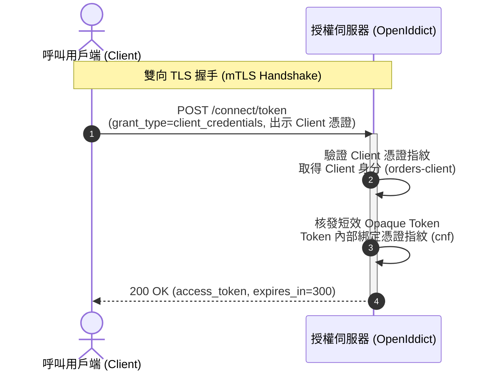
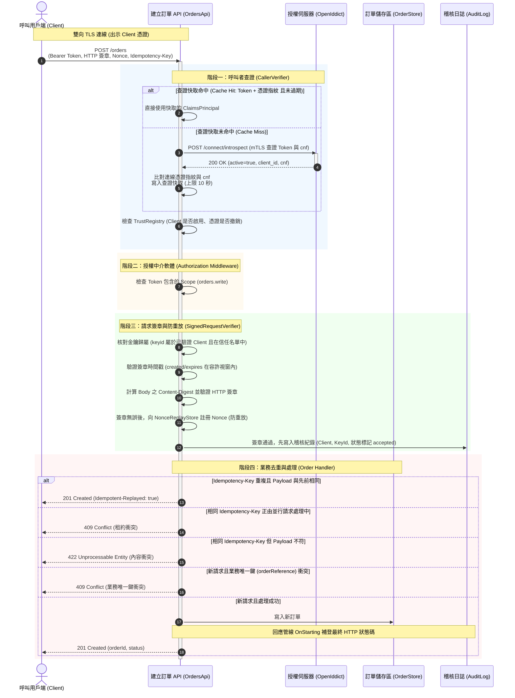
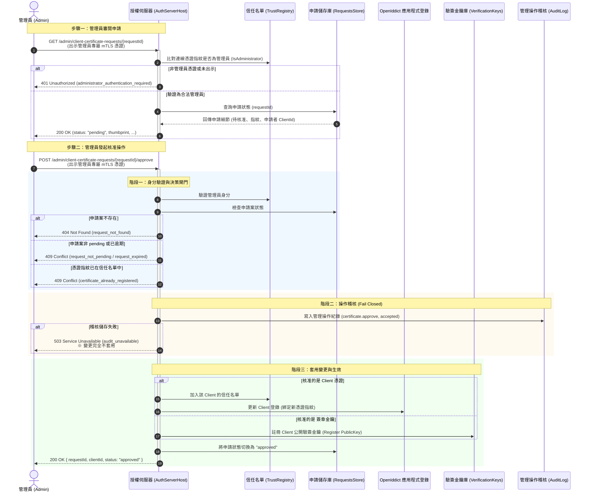
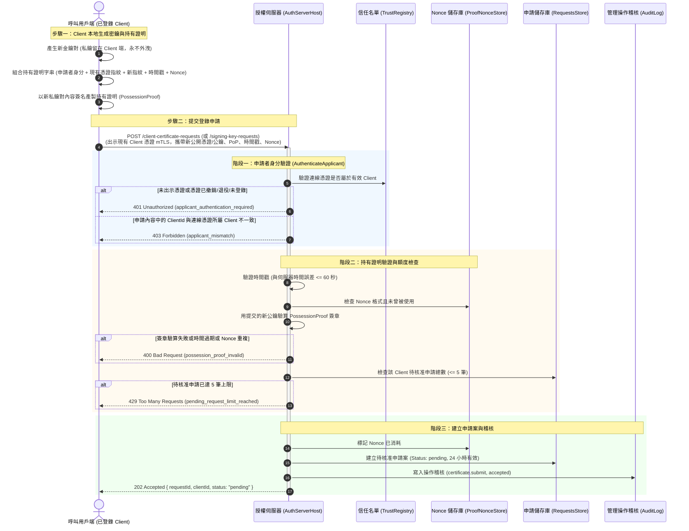
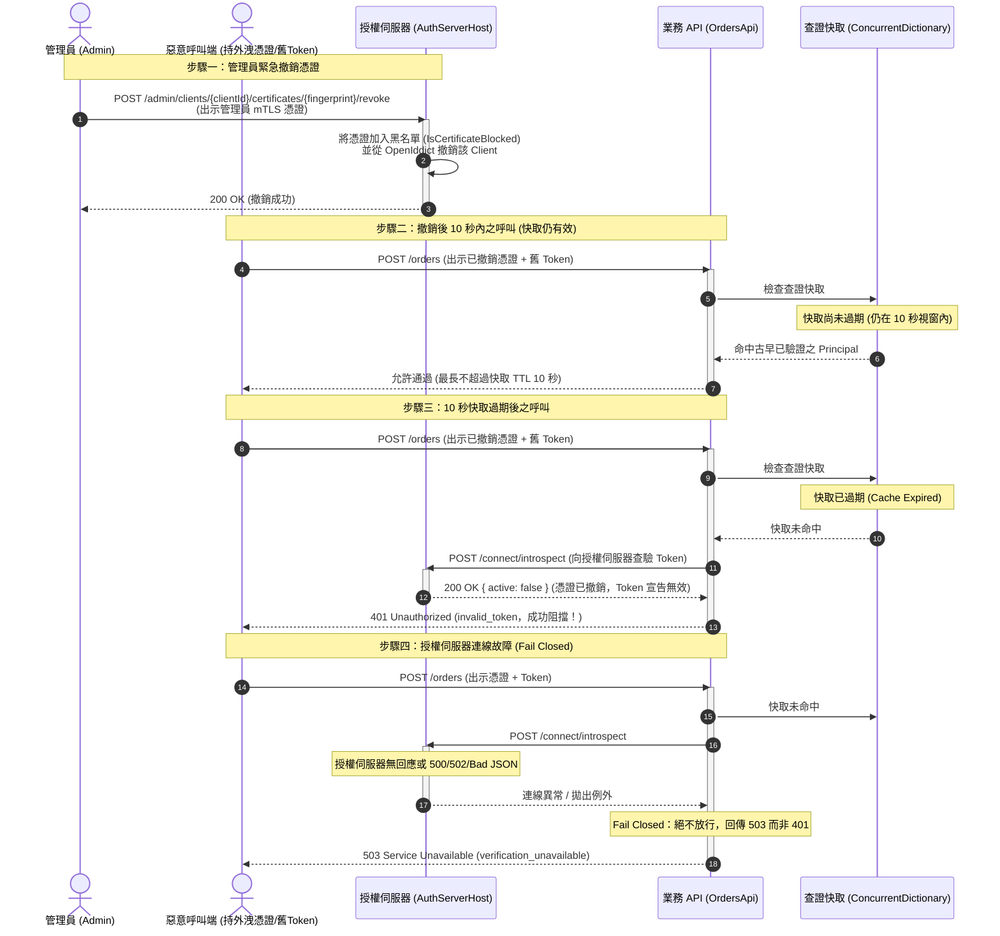
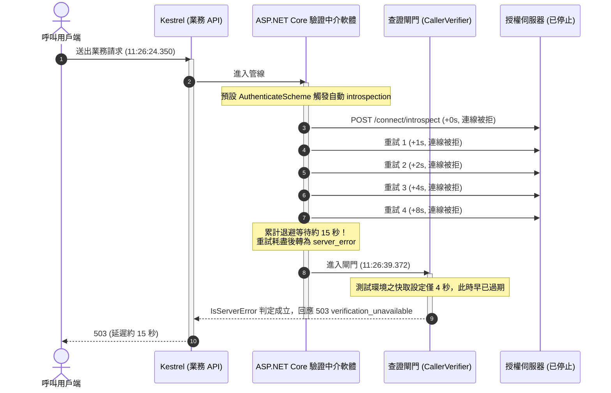
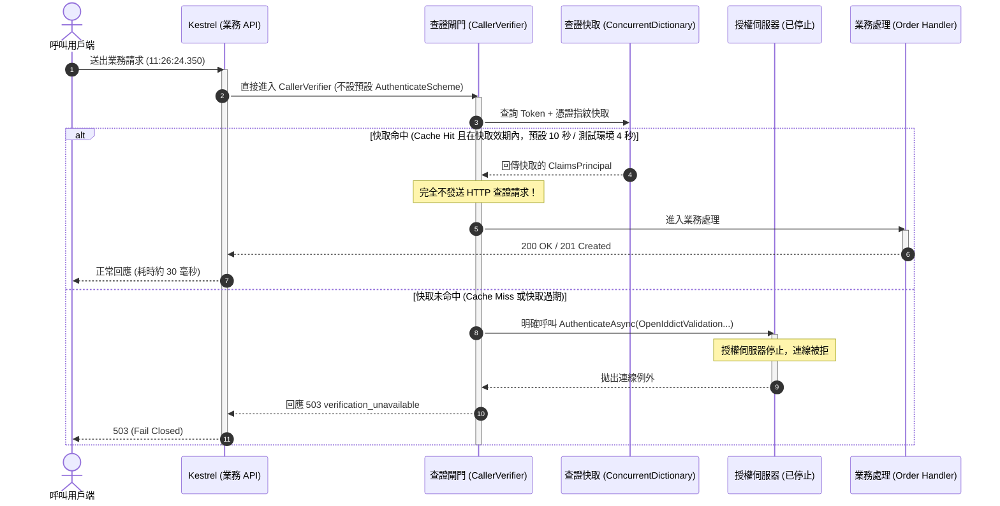

# [.NET] 服務對服務的 API 保護：mTLS 綁定 Token、請求簽章與 BDD 驗收

服務對服務 (Server-to-Server) 的 API 調用，最常見的做法通常是發一組 API Key 或 Client Secret。但這種做法最大的隱患在於：只要金鑰被偷走，任何人拿到都能直接調用；而且事後稽核很難查出到底是哪一台機器或哪一個合法用戶端發出的請求。這裡我用一個「建立訂單」的 Lab，把 Token 綁定憑證、請求簽章、防重放、冪等性、撤銷以及稽核串接起來，並且全部用 BDD 的 Scenario 來做自動化驗收。

## 開發環境

- 作業系統：Windows 11 + WSL2 (Ubuntu)
- 執行環境：.NET 10 / ASP.NET Core 10
- 授權伺服器：OpenIddict 7.7.1
- BDD 驗收測試：Reqnroll 3.3.4 + xUnit

NOTE：這裡只是 Lab 概念驗證，授權伺服器的資料採用 EF Core InMemory，憑證也是測試用的自簽憑證，不能直接拿去上正式環境。

## 要解決的問題

在規劃保護機制時，我把防護拆成多個層級，每一層各司其職擋下不同的威脅：

| 層級 | 防護目標 |
|---|---|
| mTLS + 綁定憑證的 Token | Token 被偷走時，攻擊者換了一台機器就無法使用 |
| 請求簽章 (HTTP Message Signatures) | 防止請求內容遭竄改，或冒用其他 Client 身分 |
| Nonce | 防止同一個合法請求被側錄後重放 (Replay) |
| Idempotency Key + 業務唯一鍵 | 處理網路超時重試或高併發情境，避免重複建立訂單 |
| 撤銷 + 故障閉合 (Fail Closed) | 憑證洩漏後能迅速停用；查證服務壞掉時不放行 |
| 稽核 | 追查是哪一個通過驗證的 Client 在什麼時間點做了什麼操作 |

至於 API Gateway 這一層，這裡我先不做。所有規格中跟 Gateway 相關的驗收項目，都老實標記成「本 lab 不實作，略過（非完成）」，不假裝完成。

## 整體調用流程

在進入細節前，先看一次完整的調用流程是怎麼跑的。

第一部分是用戶端向授權伺服器取得綁定憑證的 Token：



第二部分是用戶端帶著 Token 呼叫建立訂單 API。業務 API 依序執行檢查；當快取命中時，業務 API 不會連到授權伺服器：



## 1. 選型（OpenIddict）

授權伺服器不手刻 OAuth，用 OpenIddict。這裡先做一個最小的驗證專案，確認它能跑通 mTLS Client Credentials，核發綁定憑證的 Opaque Token，再用 introspection 查證。

- 只支援自簽憑證模式 (`self_signed_tls_client_auth`)
- CA 型的 `tls_client_auth` 我試了兩種做法都回 `ID2197`（無效的 TLS 客戶端憑證），這是 Lab，就不往下追了
- Token 效期 300 秒
- 開發方式採 API First，契約放在 `doc/openapi.yml`，但不用 NSwag 產生程式碼，路由是手寫的 Minimal API

NOTE：沒有 NSwag 就沒有機制保證 `openapi.yml` 和路由一致，這個例外有記在 `docs/adr/0001-lab-poc-exceptions.md`。

## 2. 憑證綁定的 Token

呼叫端用自己的憑證向授權伺服器要 Token，Token 裡帶著憑證指紋 (`cnf`)。業務 API 收到請求時，除了查 Token 是否有效，還要比對這次連線的用戶端憑證指紋。

驗收的 Scenario 長這樣：

- mTLS 認證成功後核發短效且綁定憑證的 Token
- 以 Client Secret 要求 Token 不核發
- 以 API Key 呼叫建立訂單不被接受
- 未附用戶端憑證的呼叫端不能查詢 Token 內省

沒有憑證、或用了別張憑證，呼叫都會失敗。呼叫端的身分 (`clientId`) 一律從已驗證的 Token 取得，Request Body 和 `X-Client-Id` 標頭都不採信。

### Client 與 Server 的發憑證單位是分開的嗎？

是的，兩者在實務上發證單位與驗證責任完全分開：

- **Server 憑證**：由公開信任的商業 CA（如 DigiCert、Let's Encrypt）簽發，由呼叫端的 OS 根憑證庫驗證伺服器真偽與傳輸加密。
- **Client 憑證**：由**各合作夥伴自行產生**（自簽），私鑰不出廠商機房；伺服器端不依賴外部 CA 鏈結，而是由內部**信任名單 (Trust Registry)** 比對已核准的公開指紋。

## 3. 憑證怎麼進入信任名單：管理員核准

前面的 Token 和簽章都假設憑證已經在信任名單裡，那憑證是怎麼進去的？這個 Lab 的做法是 Client 自己產生金鑰對，只把公開的部分交出來申請，由管理員核准後才生效。

- **私鑰不出 Client**：申請時只交公開憑證或公開金鑰，私鑰留在 Client 端，審核通過前處於「待核准」狀態。
- **管理員專屬身分**：管理員以專屬 mTLS 憑證存取管理端點，與業務 API 憑證嚴格互斥，不互相通用。
- **憑證與簽章金鑰分開生命週期**：兩者分開申請、分開核准，核准互不影響。
- **退役需有替代、撤銷即刻生效**：退役必須有可用替代項目；洩漏撤銷則不設限制。
- **管理稽核 Fail Closed**：操作皆寫入稽核；稽核儲存失敗則操作不生效，回應 503 `audit_unavailable`。

管理員審核與核准的循序流程如下：



NOTE：申請、信任名單與稽核紀錄都是程序內的記憶體儲存，只在單一程序內驗證，沒有持久化。另外管理操作是先寫稽核、再套用變更，如果套用時丟出例外，稽核已經記為 `accepted`，目前沒有補記失敗結果，正式採用前要補上。

### 申請者驗證

只有已登錄且有效的 Client 能為自己申請，而且必須用現有的憑證經 mTLS 驗證。申請者是以這次連線的憑證判定，申請內容裡宣稱的 Client 不採信。

- **身分判定純看 mTLS**：未驗證或已停用者回 401（不區分 Client 是否存在以防探測）；冒充他人申請回 403。
- **持有證明 (PoP)**：以新私鑰對伺服器拼裝的內容簽章（綁定申請者、新舊指紋、時間戳與一次性 Nonce）。時間誤差逾 60 秒或 Nonce 重複直接退件 400。
- **額度與時效**：待核准申請上限 5 筆（超過回 429）；申請自送出起 24 小時後自動逾期。
- **稽核分級**：被拒絕的嘗試亦記入稽核（結果標為 `rejected`），並記錄通過驗證的申請者身分以供溯源。

Client 提交申請並提供持有證明（Proof-of-Possession）的循序流程如下：



NOTE：全新 Client 的首次登錄不在這個端點的範圍，它的信任來源仍是管理員建立。上面的上限、時間窗與逾期時間都是 Lab 暫定值，issue 裡標為待使用者確認，不是已定案的規格。

## 4. 請求簽章

Token 只證明「這個 Client 能呼叫」，不證明「這份內容沒被改」。所以每個業務請求還要簽章，採用 RFC 9421 的 `ecdsa-p256-sha256`。

- 每個 Client 有獨立的 ECDSA P-256 簽章金鑰，和 mTLS 的金鑰分開
- POST 涵蓋 method、target-uri、query、authorization、content-type、content-digest、idempotency-key
- GET 涵蓋 method、target-uri、query、authorization
- 業務 API 用實際收到的 Body 重算 `Content-Digest` 來核對
- 簽章的 `keyid` 必須屬於已驗證 Token 的 `client_id`
- `created` 不能比現在超前超過 30 秒，`expires` 是 60 秒

這些數值是我提的 Lab 暫定值，issue 裡都標了「待使用者確認」。

## 5. Client 權限與業務資料範圍隔離

有了 Token 和簽章，只能證明「呼叫端合法」且「內容沒被改」，但還不能保證「他能不能做這件事」以及「他能不能動這筆資料」。

這裡我把權限分成兩層：

1. **操作權限 (Scope 白名單)**：Token 有效但缺少該操作所需的 scope（例如只有 `orders.read` 卻想取消訂單），API 直接回應 403 `Forbidden`。
2. **業務資料範圍 (Data Scope)**：即使是持有相同 scope 的不同合作廠商（例如 `orders-client` 與 `orders-partner-client`），也不能讀取或取消對方的訂單。在 handler 查不到屬於該 Client 的訂單時，一律回應 404 `Not Found`，不洩漏該訂單是否存在。

NOTE：呼叫端在 Body、Query String（`?clientId=`）或路徑中宣稱的組織或 Client 身分一律被忽略，授權判斷只採信已驗證 Token 內的 `client_id`。被拒絕的寫入請求完全不產生任何業務副作用。

## 6. 防重放與冪等

簽章裡帶 Nonce，同一個 Nonce 第二次出現就拒絕。合法的重試要重簽（換新的 Nonce 和時間），所以防重放和重試不衝突。

重試最後不能多建訂單，這靠兩件事：

1. `Idempotency-Key`：保存 24 小時，最長重試窗 10 分鐘
2. 業務唯一鍵：Body 的 `orderReference`，同一個 Client 底下不能重複，不受 Key 過期影響

處理中的請求有 30 秒的租約，併發的第二個請求會拿到 409。結果相同的重試回 201，並帶 `Idempotent-Replayed: true`。

NOTE：取消訂單的 POST 本來被我要求一定要帶 Idempotency-Key，Code Review 時被抓到這個要求沒有對應的去重語意。取消天生是冪等的，後來就拿掉了。

## 7. 撤銷與 Fail Closed

憑證洩漏時要能停用，而且要在 60 秒內生效。業務 API 會快取查證結果（上限 10 秒），所以撤銷最慢就是等快取過期。實測 Token 撤銷約 10 秒，Client、憑證、簽章金鑰撤銷則是立刻生效。

查證服務壞掉時不能放行，也不能誤判成憑證失效：

以下是 Introspection 查證異常時的 BDD 驗收規格：

```gherkin
Scenario Outline: introspection 回應 <情境> 時回 503 而非 401
  Given 查證服務以假的授權伺服器取代，introspection 行為為 "<行為>"
  When 呼叫端持任意 Token 查詢訂單
  Then 查證故障情境的回應為 <狀態>

  Examples:
    | 情境        | 行為       | 狀態 |
    | 502         | status-502 | 503  |
    | 500         | status-500 | 503  |
    | 壞掉的 JSON | bad-json   | 503  |
    | 空內容      | empty      | 503  |
    | inactive    | inactive   | 401  |
```

只有 Token 明確是 inactive 才回 401，其他任何異常一律回 503 `verification_unavailable`。

管理員撤銷憑證後，業務 API 快取過期並依序阻擋的循序流程如下：



## 8. 稽核

稽核記錄的是「已驗證」的呼叫者：Client、簽章金鑰識別、操作、結果。簽章沒通過的請求，Token 裡的 Client 只能標成「未驗證」。稽核不記 Token、標頭值、簽章基底、私鑰和 Body。

寫入稽核失敗時回 503 `audit_unavailable`，不建立訂單，這也是 Fail Closed。

最初的版本在簽章通過後、業務處理前就寫稽核，Code Review 發現這樣缺了「結果」。後來在回應送出時補上最終的 HTTP 狀態碼 (`ResultStatus`)。

## 9. 用 BDD 驗收

每個驗收項目都要有對應的 Scenario，Scenario 先寫、先看到紅燈再實作。Cucumber 的保留字（Feature、Scenario、Given、When、Then）用英文，步驟用中文。測試跑在真實的 Kestrel TLS 上，不是用 mock 的 HttpClient。

最後的結果是 334 個通過、0 失敗、2 個略過（Gateway 的 `@ignore`），這包含後來加上的管理員核准與申請者驗證的 Scenario。

有些項目只是決策或紀錄（例如 Token 效期有沒有被確認），沒辦法用行為驗證。這類 Scenario 我標成 `@record`，在 issue 的對應表裡獨立列出來，不冒充行為驗證。一開始我偷懶把它們勾成完成，被 Code Review 抓到，後來才改成這樣。

## 10. 踩雷：每個請求多等 15 秒

撤銷的測試有一個情境要把授權伺服器停掉，確認快取過期前還能放行，過期後回 503。結果快取只有 4 秒，第一個請求卻要等約 15 秒才進到業務邏輯，快取早就過期，測試一直失敗。

我一開始懷疑是 HttpClient、mTLS 憑證鏈或 DNS，量測後都排除了。分段量測的結果是：

- Kestrel 收到請求是 11:26:24.350，進到驗證閘門是 11:26:39.372
- 中間對授權伺服器的 `POST /connect/introspect` 重試了好幾次：24.353、25.360、27.361、31.363
- 每次都是 `ConnectFailed 10061`（連線被拒），間隔剛好 1、2、4、8 秒，合計約 15 秒

先用循序圖看修正前的狀況。驗證中介軟體在每個請求都先去查授權伺服器，導致退避重試卡住：



再來看修正後的處理流程。快取命中的請求直接通過，完全不碰授權伺服器：



根因是這段設定：

```csharp
builder.Services.AddAuthentication(OpenIddictValidationAspNetCoreDefaults.AuthenticationScheme);
```

這等於設了預設的 Authenticate scheme，ASP.NET Core 的驗證中介軟體會在每個請求進到我自己的 `CallerVerifier` 之前，先自動對授權伺服器做一次 introspection。後果有兩個：

1. 查證快取形同虛設，就算快取命中，中介軟體照樣去查，結果還被丟掉
2. 授權伺服器掛掉時，每個請求都先吃完 OpenIddict 的指數退避重試

修正是不設預設的 Authenticate scheme，只保留 Challenge 和 Forbid，並且在快取未命中時才明確指定 scheme 呼叫：

以下是修正後的驗證服務註冊與明確調用方式：

```csharp
builder.Services.AddAuthentication(options =>
{
    options.DefaultChallengeScheme = OpenIddictValidationAspNetCoreDefaults.AuthenticationScheme;
    options.DefaultForbidScheme = OpenIddictValidationAspNetCoreDefaults.AuthenticationScheme;
});

// CallerVerifier：快取未命中時才查
result = await context.AuthenticateAsync(OpenIddictValidationAspNetCoreDefaults.AuthenticationScheme);
```

修正後同一個快取命中的查詢從約 15 秒降到約 30 毫秒。我另外加了一個 Scenario，檢查快取命中的查詢在 2 秒內完成。

NOTE：快取未命中而且授權伺服器真的掛掉時，單一請求還是要等約 15 秒才回 503，這是 OpenIddict 預設的重試。要縮短可以用 `SetHttpResiliencePipeline`，這個 Lab 我沒動。

## 心得

- **分層防禦便於定位**：將保護拆成多層並配對獨立 Scenario，哪一層沒擋住立刻顯現。
- **Fail Closed 需逐一驗收**：502、500、無效 JSON、空內容等異常皆須獨立測試通過。
- **雙軸審查抓盲點**：實作完成後執行 Standards 與 Spec 雙軸審查，抓出稽核缺結果、取消端點不該強加 Idempotency-Key、假 TDD 改以 `@record` 鎖定，以及 Client 身分不可採信 Body/Header 等實務盲點。
- **誠實標記邊界**：未實作的 Gateway 與需手動確認的項目如實標記 `@ignore` 與 `@record`，不粉飾進度。
- **已知侷限**：跨執行個體與防重放鎖目前在記憶體內模擬；正式環境需補齊外部分散式快取與多方核准流程。

完整代碼位置: https://github.com/yaochangyu/sample.dotblog/tree/master/Security/Lab.Creds.WebApi
